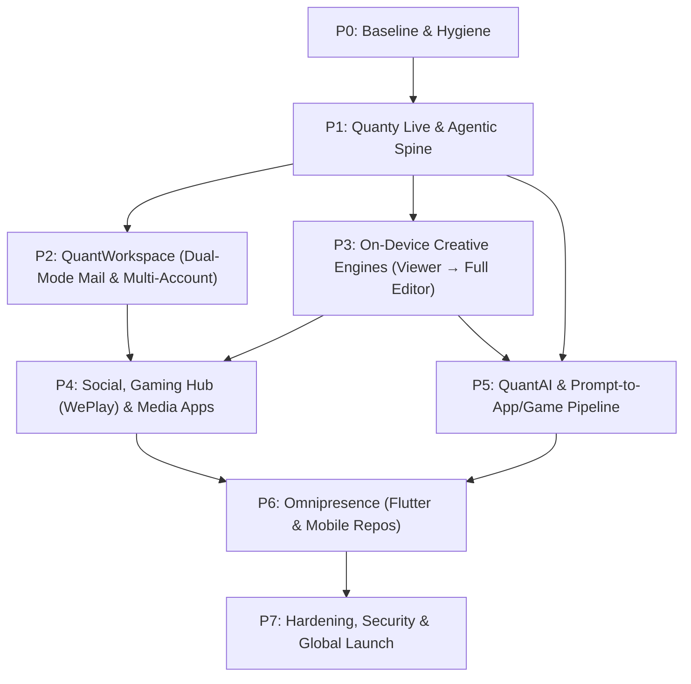
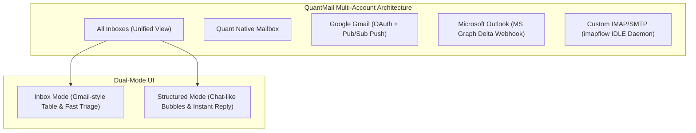
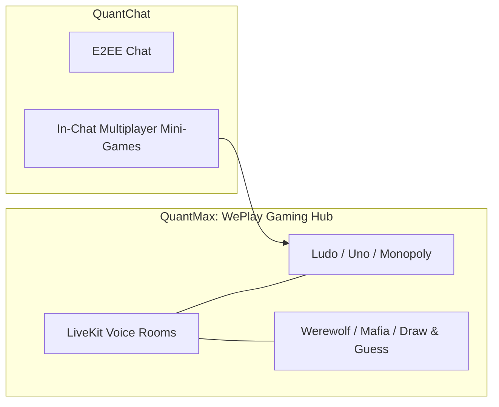
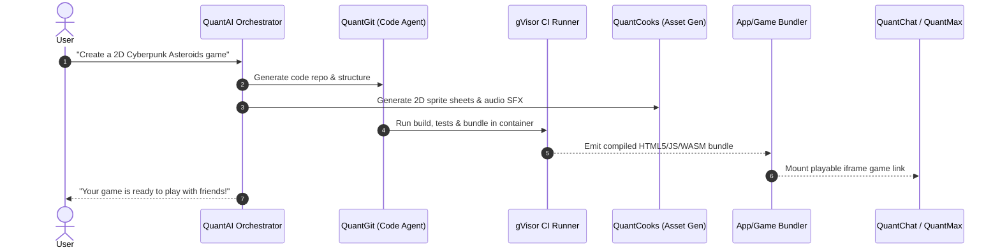

# 🗺️ QUANT ECOSYSTEM — MASTER PLAN (Phase by Phase)

> **Source of Truth** for ecosystem architecture, execution order, and verification gates.  
> **Linked Artifacts**: [PROJECT_STRUCTURE.md](PROJECT_STRUCTURE.md) · [UI_UX_SPEC.md](UI_UX_SPEC.md) · [AGENT_MEMORY.md](AGENT_MEMORY.md)  
> **Core Vision**: An omnipresent, Google-Workspace-easy ecosystem governed by **Quanty Live** (background autonomous agent), operating across 9 integrated sovereign apps and 13 on-device open-source creative/productivity engines—built with zero paid API dependencies and zero mock data in production.

---

## 0. GATES & GOVERNANCE

### 0.1 Definition of Done (Strictly Enforced)
A task is marked done (**☑**) only when all 8 gates pass with recorded terminal/browser proof:
1. **Zero Mock Data**: Production code paths use real PostgreSQL/Prisma or live network calls. No fake JSONs or random math.
2. **Type Cleanliness**: `pnpm --filter <app/package> exec tsc --noEmit` exits `0`.
3. **Automated Tests**: `pnpm --filter <app/package> test` passes; new features include dedicated Vitest test suites.
4. **Live Backend Verification**: Live HTTP/WebSocket request against running Fastify/Next.js services returns verified `2xx` / valid frames.
5. **Live Chrome UI/UX Verification**: DevTools MCP verified at **1440px** (Desktop), **768px** (Tablet), and **390px** (Mobile). Zero console errors, zero uncaught network errors.
6. **Luxury Obsidian Theme Compliance**: Strict adherence to `#090A0E` (Canvas), `#111318` (Panel), `#FF7A00` (Quant Orange accent), 52px topbars, and a11y contrast ratios.
7. **Security & RBAC**: Zod schema input validation, fail-closed JWT/session auth, tenant isolation, and no secrets in source.
8. **Licensing Compliance**: Strictly Apache-2.0 / MIT upstream engines with preserved copyright in `engines/licenses/NOTICES.txt`. No unfree code (e.g., `AniCraft` without LICENSE is barred).

---

## 1. ECOSYSTEM ARCHITECTURE & ROADMAP



---

## PHASE 0 — TRUTH, BASELINE & HYGIENE

**Goal**: Establish a mathematically verified baseline across all monorepo apps and packages.

| Task ID | Component | Objective & Implementation Details | Verification Gate | Status |
| :--- | :--- | :--- | :--- | :--- |
| **P0-1** | `QuantMax` Role Pivot | Deprecate dating/Omegle hybrid (`matching.service.ts`, `virtual-dates.tsx`). Re-orient QuantMax as the **WePlay-style Social Gaming Hub** (voice rooms + party games). | Architecture decision recorded; unused routes pruned. | ◐ |
| **P0-2** | `QuantWave` Audit | Verify microblogging/spaces/threads role (`backend/routes/feed.ts`, `posts.ts`, `spaces.ts`). Prune legacy 17 pages-router files in `quantwave/src/legacy-pages/`. | Build passes with zero dead file imports. | ☐ |
| **P0-3** | Monorepo Baseline | Execute `pnpm -r exec tsc --noEmit` and `pnpm test` across all 9 apps. Record baseline pass/fail matrix in `docs/baselines/`. | Baseline markdown generated; blockers cataloged. | ☐ |
| **P0-4** | Repo Hygiene | Move tracked ad-hoc artifacts (`mobile/`, `web/`, `screens/`, `quanty/`, `pureblack-shots/`) to `docs/archive/`. | `git status` clean; C: free space > 15 GB guarded. | ☐ |
| **P0-5** | Commit Core Specs | Commit master documentation anchors: `PROJECT_STRUCTURE.md`, `UI_UX_SPEC.md`, `AGENT_MEMORY.md`, `MASTER_PLAN.md`. | Git commit hash recorded on `main`. | ☐ |

---

## PHASE 1 — QUANTY LIVE & AGENTIC SPINE

**Goal**: An always-on, autonomous personal background agent (GrokBot / OpenDots / Clawdbot parity) operating across all sovereign apps—headquartered in **QuantMail** (Live Agent + Search Agent) and **QuantChat** (Sovereign AI Contact), sharing one persistent PostgreSQL memory brain, with intelligent notification routing to prevent user alert fatigue.

```mermaid
flowchart LR
  subgraph User Surfaces
    QMailLive["QuantMail Live Agent (Floating Avatar + Pulse Highlights)"]
    QMailSearch["QuantMail Search Agent (Copilot Drawer)"]
    QChatBot["QuantChat Native AI Contact (Grok / OpenDots Style)"]
  end
  subgraph Quanty Core
    Heartbeat["BullMQ Heartbeat Daemon (HEARTBEAT.md)"]
    Memory["Prisma AIMemoryStore (Postgres: ai_memory_entries)"]
    Router["Notification Deduplication & Anti-Fatigue Router"]
    Registry["Unified Tool Registry (@quant/tool-registry)"]
  end
  subgraph Real Executors
    AppConnectors["Mutating App Connectors (Mail / Calendar / Drive / Git)"]
    UIAction["Browser UI Runner (targetSelector Highlights)"]
    Sandbox["gVisor Container Sandbox (ci-runner)"]
  end
  User Surfaces --> Quanty Core
  Heartbeat --> Router
  Router --> Registry
  Registry --> Real Executors
```

| Task ID | Feature | Implementation Specifications | Verification Gate | Status |
| :--- | :--- | :--- | :--- | :--- |
| **P1-1** | **Unified Tool Registry** | Create `@quant/tool-registry` with typed schemas, risk classifications (`read`, `write`, `destructive`), idempotency keys, and receipt-before-success validation contract. | Unit tests verifying schema parsing and execution contracts. | ☐ |
| **P1-2** | **App Connectors Fix** | Reconcile `apps/quantai/backend/services/cross-app-orchestrator.service.ts` with real endpoints: eliminate `:3999` Drive stub, fix Mail/Chat routes, wire mutating endpoints (`code.createRepo`, `code.commitFiles`). | Contract tests against running services; 100% 2xx responses. | ☐ |
| **P1-3** | **Persistent Heartbeat Daemon** | Replace in-memory Map in `apps/quantai/backend/services/scheduled-tasks.service.ts` with a durable **BullMQ + Redis / PostgreSQL** worker. Implements `HEARTBEAT.md` recurring wakes (daily briefings, background triage, inbox scanning). | Background task survives server restart; executes scheduled job with real logs. | ☐ |
| **P1-4** | **UI-Action Automation Protocol** | Enhance client-side execution protocol in `apps/quantmail/src/components/QuantyLiveAgent/`: Quanty executes UI actions directly on screen (auto-populating forms, highlighting rows with `QuantyActionHighlight.tsx`) so the user watches Quanty work live without touching the phone/keyboard. | Live Chrome recording showing autonomous action execution with pulse rings. | ☐ |
| **P1-5** | **QuantChat Sovereign AI Contact** | Integrate Quanty as a permanent, first-class AI contact in `apps/quantchat` (Grok / OpenDots parity) backed by `voice-bot-agent.service.ts` and `@quant/ai`. Supports direct text conversations, LiveKit WebRTC HD voice calls, and task dispatching—eliminating any need for third-party WhatsApp or Telegram dependencies. | Real user in QuantChat sends text/voice message to Quanty; receives contextual response and task status. | ☐ |
| **P1-6** | **Durable Shared Memory Brain** | Wire `packages/ai-memory/src/prisma-store.ts` (`ai_memory_entries`) across both QuantMail and QuantChat. Tasks given in QuantChat reflect in QuantMail's inspector popup, and vice-versa, sharing single user context. | Cross-app memory roundtrip test; task dispatched from QuantChat visible in QuantMail. | ☐ |
| **P1-7** | **Consent & Approvals Gate** | Destructive actions (send email, delete files, merge code, execute financial transactions) render interactive user approval cards in `QuantyApprovalsTab` with one-time or standing consent flags. | UI card renders in Chrome; action blocked until approval. | ☐ |
| **P1-8** | **Anti-Fatigue Notification Router** | Build a smart notification broker: routine background actions (e.g., auto-categorized 10 newsletters) log silently into `QuantyActivityTab`. Non-urgent updates bundle into a single consolidated morning/evening digest in QuantChat. Urgent push notifications trigger ONLY when user approval is required. | Verification test: 20 background tasks emit 0 spam notifications; 1 digest delivered to QuantChat. | ☐ |

---

## PHASE 2 — QUANTWORKSPACE (Google-Workspace-Easy Super App)

**Goal**: Full Google Workspace parity inside `apps/quantmail` (Mail, Calendar, Drive, QuantGit, Contacts), featuring Dual-Mode QuantMail and Unified Multi-Account integration.



| Task ID | Feature | Implementation Specifications | Verification Gate | Status |
| :--- | :--- | :--- | :--- | :--- |
| **P2-1** | **ConnectedAccount Data Model** | Extend `packages/database/prisma/schema.prisma` with `ConnectedAccount` (`provider: QUANT \| GMAIL \| OUTLOOK \| IMAP_SMTP`, credentials encrypted with KMS, sync tokens, status, color tags). Add `accountId` foreign key to `Email`, `EmailThread`, and `EmailSignature`. | `pnpm db:generate` & migration passes; zero schema regressions. | ☐ |
| **P2-2** | **External Email Sync Daemons** | Implement multi-provider sync services:<br>1. **Gmail**: Google Pub/Sub push notification listener + incremental history API.<br>2. **Outlook**: Microsoft Graph delta sync webhooks.<br>3. **IMAP**: Persistent IDLE socket listener via `imapflow` with auto-reconnect. | Real email sent to connected test inbox appears in database < 2 seconds. | ☐ |
| **P2-3** | **Unified Multi-Account UI** | Build the left-rail account switcher in `apps/quantmail/src/components/navigation/`: "All Inboxes" aggregate feed, individual account filters with distinct color tags (`#EA4335` Google red, `#0078D4` Outlook blue, `#FF7A00` Quant orange), and dynamic `From:` alias selector in `EmailComposer.tsx`. | Chrome test at 1440px and 390px; switching accounts filters thread list instantly. | ☐ |
| **P2-4** | **Dual-Mode Mailbox UX** | Implement seamless toggle between **Standard Table Inbox** (`<InboxPageContent />`) and **Structured Chat View** (`<ConversationalThreadView />` / `<PersonThread />`) via keyboard shortcut (`V`) or top-bar toggle button. | Chrome interaction test; mode switches with zero layout shift or state loss. | ☐ |
| **P2-5** | **Calendar Parity** | RFC 5545 iCalendar support, recurring event RRULE parsing, free/busy slot finder, public booking page, and automatic LiveKit meeting URL generation. | Booking flow tested end-to-end; `.ics` invite sent and parsed. | ☐ |
| **P2-6** | **Drive & File Sharing** | Shared team drives, granular permissions (Viewer, Commenter, Editor), password/expiry protected share links, version history, and file request uploads. | File upload, link generation, and permission verification in live Chrome. | ☐ |
| **P2-7** | **QuantGit Sovereign Cloud ("Quant Builds Quant")** | Transform QuantGit into a self-hosting developer platform capable of hosting and developing the entire Quant Ecosystem monorepo:<br>1. **Sovereign Git Server**: Bare mirror import (`RepoMigrationService`), SSH key authentication, Git HTTP smart transfer protocol (`git-upload-pack`, `git-receive-pack`), inline 3-way PR diff review comments, and squash/rebase merge.<br>2. **Cloud Codespaces Workspace**: In-browser Monaco/WebContainer editor (`CloneCodespacesMenu.tsx`) connected to sandboxed `services/ci-runner` gVisor dev containers with live interactive terminal (`BuildTerminal.tsx`).<br>3. **Autonomous AgentLab Fleet**: Wire `packages/code-agent` into `AgentsTab.tsx` (Autonomous Swarm Fleet Command) and `CopilotFleetModeView.tsx`—agents read issues/prompts, edit code in gVisor sandbox, run `pnpm test`, fix lint errors, and open PRs with verified test proof.<br>4. **Self-Healing CI Pipeline**: Connect `ActionsTab.tsx` to `services/ai-ci-fix.service.ts` so failing CI runs trigger automated fix branches and self-healing pull requests.<br>5. **Self-Hosting Bootstrap Drill**: Complete one-click migration of the `Quant-Ecosystem` repository from GitHub into QuantGit, and verify an autonomous commit, PR review, and build pass running entirely on QuantGit. | Real bare repository migration executed; autonomous coding agent solves an issue, passes CI, and merges PR in live Chrome without external GitHub dependencies. | ☐ |
| **P2-8** | **Omnibox & Shell (Cmd+K)** | Universal modal search bar across emails, files, calendar events, code repositories, and chats, plus direct "Ask Quanty" inline action execution. | Search returns aggregated results across all pillars in < 300ms. | ☐ |

---

## PHASE 3 — ON-DEVICE CREATIVE ENGINES (Viewer → Full Editor)

**Goal**: Transform the 13 Rust/WASM engines from read-only renderers into full-featured, on-device interactive editors running inside Web Workers—shipped under Quant brand with zero paid dependencies.

| Engine Product Name | Upstream Engine | Capabilities to Deliver | Integration Surface | Status |
| :--- | :--- | :--- | :--- | :--- |
| **Quant Docs** | `WordCraft` | In-browser WYSIWYG rich text editor, tables, styles, track changes, comments, DOCX/PDF export. | QuantDrive, QuantMail Composer | ☐ |
| **Quant Sheets** | `GridCraft` | Cell editing, Excel formula engine, charts, sorting, filtering, 100k+ cell virtualization, XLSX/CSV export. | QuantDrive, QuantAds Reporting | ☐ |
| **Quant Slides** | `DeckCraft` | Slide creation, vector shapes, animations, layout presets, presenter mode, PPTX/PDF export. | QuantDrive | ☐ |
| **Quant PDF** | `PdfCraft` | Form filling, digital signatures, annotations, highlights, redactions, page split/merge. | QuantDrive, QuantMail Attachments | ☐ |
| **Quant Design** | `FigCraft` + `DesignCraft` | Vector canvas, pen tool, layer management, typography, SVG/PNG export, IDML/INDD import. | QuantDrive, QuantAds Creative Studio | ☐ |
| **Quant Photo** | `PhotoCraft` + `LightCraft` | Non-destructive RAW/photo manipulation, layers, blend modes, adjustments (curves, HSL), filters. | QuantGram Photo Editor, QuantDrive | ☐ |
| **Quant Studio** | `FilmCraft` | Multi-track timeline video editing, cuts, transitions, title overlays, kinetic text. | QuantCooks Timeline Studio | ☐ |
| **Quant Motion** | `EffectCraft` | Keyframe animation, particle effects, motion graphics, compositing. | QuantCooks Motion Engine | ☐ |
| **Quant Sound** | `SoundCraft` | Multi-track audio workstation, waveform scrubbing, noise reduction, audio mastering. | QuanTube Audio Dock, QuantCooks | ☐ |
| **Quant CAD** | `CADCraft` | 2D/3D DWG/DXF computer-aided design viewer, measurement tools, layer toggling. | QuantDrive CAD Viewer | ☐ |
| **Quant Animation** | *Permissive Alt* | 2D vector animation. **Strict policy**: AniCraft is barred due to missing license; use BSD-3-Clause / MIT alternative. | QuantCooks 2D Animation | ☐ |

---

## PHASE 4 — SOCIAL, GAMING HUB (WEPLAY) & MEDIA APPS

**Goal**: Sovereign social platforms with high-retention social gaming, streaming, and creator monetization.



| Task ID | Pillar / App | Feature & Implementation Specifications | Verification Gate | Status |
| :--- | :--- | :--- | :--- | :--- |
| **P4-1** | **QuantMax: WePlay Pivot** | Re-architect `apps/quantmax` into a **WePlay-style Social Gaming Hub**: LiveKit multi-user voice rooms with synchronized game canvases overlaid directly inside the audio room. | 4 real browser tabs join voice room and interact with synchronized canvas. | ☐ |
| **P4-2** | **Realtime Game Synchronizer** | Build a room-multiplexer in `services/ws-gateway` to handle game state broadcast, turn order, disconnect reconnections, and action validation using `packages/cross-app-gaming`. | Stress test: 100 concurrent game action events synced < 50ms latency. | ☐ |
| **P4-3** | **Party Games Suite** | Implement missing party game engines:<br>1. **Werewolf / Mafia**: Role distribution, night/day cycles, live voting state machine.<br>2. **Draw & Guess**: Realtime collaborative canvas streaming vector points with NLP guess matcher.<br>3. **Ludo & Uno**: Wire existing `packages/cross-app-gaming` engines to the WebSocket gateway. | End-to-end match of Werewolf and Ludo played between automated browser clients. | ☐ |
| **P4-4** | **QuantChat In-Chat Gaming** | Embed party games directly inside 1-on-1 and group chats via `GameLauncher.tsx` and `apps/quantchat/src/lib/games-sdk.ts`, enabling instant multiplayer challenges. | Live chat message launches game invitation; recipient taps to join active match. | ☐ |
| **P4-5** | **QuantGram Reels & Stories** | Sliding window reel player (3-controller reuse), gesture physics, camera capture with filters, sound reuse (`SoundTrack`), and 24h stories viewer. | Smooth 60fps reel scrolling verified on mobile viewport in Chrome DevTools. | ☐ |
| **P4-6** | **QuanTube Live & Audio Dock** | Adaptive HLS ladder playback, resumable video upload pipeline (`video-transcoder`), live stream tip gifts via `@quant/quant-economy`, and background PiP music player. | HLS stream playback and wallet debit/credit verified on live stream. | ☐ |
| **P4-7** | **QuantAds OpenRTB Exchange** | OpenRTB 2.5 compliant DSP/SSP auction engine, banner/video creative validation using Quant Design, real-time budget pacing, and creator revenue share ledger. | Auction test: synthetic bid request matches with win notice and ledger settlement. | ☐ |

---

## PHASE 5 — QUANTAI & "PROMPT-TO-GAME/APP" PIPELINE

**Goal**: Full Agent OS with real-time voice orb, dynamic canvas, and the end-to-end autonomous pipeline: *Natural language prompt $\to$ QuantGit coding agent $\to$ QuantCooks assets $\to$ sandboxed build $\to$ playable game/app*.



| Task ID | Feature | Implementation Specifications | Verification Gate | Status |
| :--- | :--- | :--- | :--- | :--- |
| **P5-1** | **QuantAI Orchestrator Bridge** | Extend `cross-app-orchestrator.service.ts` with mutating Git and asset tools: `code.createRepository`, `code.commitFiles`, `asset.generateSprites`, `ci.triggerBuild`. | Tool invocation executes successfully without errors. | ☐ |
| **P5-2** | **QuantCooks Asset Pipeline** | Implement a 2D/3D game asset synthesis service in `apps/quantcooks`: procedural sprite generation, texture atlas creation, and 3D GLTF model conversion via open-source pipelines. | Generated sprite sheet and sound effect saved to Drive asset vault. | ☐ |
| **P5-3** | **Sandboxed Compiler & Bundler** | Connect `packages/code-agent` to `services/ci-runner` (gVisor `runsc` sandbox) to compile TypeScript/Canvas games into self-contained HTML5/WASM bundles. | Sandbox compiles bundle safely; non-zero exit on malicious code. | ☐ |
| **P5-4** | **Instant App/Game Host** | Deploy a dynamic hosting route in `apps/quantai` or `services/ws-gateway` that serves generated bundles and exposes the `quant-game.js` iframe SDK for instant play. | Browser loads compiled game bundle; inputs responsive and game loop running. | ☐ |
| **P5-5** | **Real-Time Voice Orb** | Real-time bidirectional voice assistant powered by LiveKit WebRTC and Gemini Live API with low-latency barge-in and conversational memory. | Measured voice response round-trip latency < 800ms. | ☐ |
| **P5-6** | **Agent OS Canvas** | Side-by-side interactive document and code canvas with live previews, syntax highlighting, and bidirectional sync to Quant Docs / QuantGit. | Code edited in canvas reflects immediately in live preview pane. | ☐ |

---

## PHASE 6 — OMNIPRESENCE (Flutter & Cross-Platform)

**Goal**: Seamless cross-platform availability across Android, iOS, Windows, macOS, and Linux.

| Task ID | Component | Implementation Specifications | Verification Gate | Status |
| :--- | :--- | :--- | :--- | :--- |
| **P6-1** | **Quant-Mobile Repository** | Extract `flutter_apps/` into dedicated `Quant-Mobile` repo with preserved git history; maintain Melos monorepo workspace for all mobile clients. | Fresh clone builds APK on Android toolchain without missing dependencies. | ☐ |
| **P6-2** | **Offline-First Synchronization** | Implement local SQLite storage via Drift with optimistic mutations and background delta-sync queue reconciling with server PostgreSQL. | Airplane mode test: messages and emails written offline sync immediately on reconnect. | ☐ |
| **P6-3** | **Native FFI Rust Engines** | Compile Rust engines to native C dynamic libraries (`cdylib`) and bind via `flutter_rust_bridge` for zero-overhead local document/media rendering. | High-resolution PDF opens natively in Flutter app < 200ms without network. | ☐ |
| **P6-4** | **Adaptive Device Layouts** | Responsive UI adapting cleanly across smartphones (390px), foldable screens, tablets (768px), and desktop desktop windows (1440px). | Flutter widget tests passing across all screen constraint profiles. | ☐ |

---

## PHASE 7 — HARDENING, SECURITY & PRODUCTION LAUNCH

**Goal**: Enterprise-grade security, fault tolerance, observability, and smooth staged rollout.

| Task ID | Scope | Implementation Specifications | Verification Gate | Status |
| :--- | :--- | :--- | :--- | :--- |
| **P7-1** | **Security & Authz Audit** | Complete security audit across all API routes: enforce strict tenant isolation, verify CSRF/XSS protection, and conduct automated penetration test scans. | Automated vulnerability scan returns zero high/critical CVEs. | ☐ |
| **P7-2** | **Performance & Load Budgets** | Perform load testing with k6: 10,000 concurrent WebSocket connections on `ws-gateway`, API p95 latency < 120ms, Web Vitals LCP < 1.8s. | k6 benchmark report stored in `docs/benchmarks/`. | ☐ |
| **P7-3** | **Observability & Health SLOs** | Distributed tracing and error telemetry via OpenTelemetry, Prometheus metrics, and automated alert triggers. | Synthetic crash triggers alert and auto-healing runbook execution. | ☐ |
| **P7-4** | **Staged Deployment Rollout** | Production Kubernetes (EKS) rollout: blue/green deployment strategy, automated canary verification, and zero-downtime database migrations. | All 21 production service pods healthy; zero downtime during rolling update. | ☐ |

---

## 2. ACTIVE SPRINT TRACKER

| Phase | Status | Active Focus | Primary Blockers | Next Verification Action |
| :---: | :---: | :--- | :--- | :--- |
| **P0** | **IN PROGRESS** | Hygiene, baselines, and spec alignment | Disk space guard (maintain > 15 GB free) | Run `pnpm -r exec tsc --noEmit` baseline |
| **P1** | **READY** | Quanty Live heartbeat daemon & tool registry | P0 baseline verification | Implement `ConnectedAccount` Prisma model |
| **P2** | **QUEUED** | QuantMail Dual-Mode & Multi-Account sync | P1 tool contracts | Build Gmail/Outlook/IMAP sync daemons |
| **P3** | **QUEUED** | Upgrading Craft engines to full editors | P0 baseline verification | WASM compilation and Web Worker harnesses |
| **P4** | **QUEUED** | QuantMax WePlay transformation & gaming | P1 WebSocket room multiplexer | LiveKit voice room + Ludo canvas integration |
| **P5** | **QUEUED** | Prompt-to-App/Game autonomous pipeline | P1 CI runner sandbox | QuantAI to QuantGit code agent bridge |
| **P6** | **QUEUED** | Mobile repo extraction & Flutter client | P2 API stability | Melos workspace verification |
| **P7** | **QUEUED** | Hardening & Production Launch | P1-P6 completion | Staged canary rollout on EKS |
