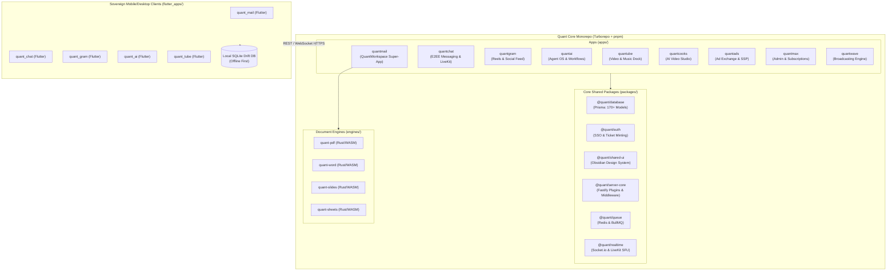

# 🌌 QUANT ECOSYSTEM — DEFINITIVE MASTER ARCHITECTURE & PROJECT STRUCTURE

> **Version**: 2.0.0 (Post-Forensic Audit 2026)  
> **Repository Commit**: `c10a06737` (origin/main)  
> **Status**: Verified Live Architecture & Production Blueprint  
> **Primary Monorepo Tooling**: Turborepo + pnpm 9.x + Melos (Flutter)

---

## 🧭 1. ECOSYSTEM TOPOLOGY & REPOSITORY ARCHITECTURE

The Quant Ecosystem is structured as a **Sovereign Multi-App Monorepo** designed for omnipresence across Web, Mobile, and Desktop.



### Monorepo vs Multi-Repo Strategy:
1. **Web Apps & Microservices (Stay Unified in Monorepo)**:
   - **Horizontal Coupling = 0**: None of the 9 web apps import code directly from each other.
   - **Vertical Coupling = High**: All 9 apps share `@quant/database` (Prisma with 170+ models) and `@quant/auth`. Splitting web apps into 9 repositories would introduce massive npm package publishing overhead, schema version drift, and broken cross-app SSO.
2. **`flutter_apps/` (Extractable into `Quant-Mobile`)**:
   - Flutter uses Dart + Melos and has **0% dependency on Node.js/pnpm/Prisma**.
   - Connects strictly over HTTP/WebSocket and maintains an independent SQLite Drift local database.
   - Splitting `flutter_apps/` into a dedicated `Quant-Mobile` repo isolates Dart toolchains, accelerates mobile CI/CD pipelines, and eliminates monorepo lockfile bloat.

---

## 🏢 2. THE 9 SOVEREIGN APPS & PORT MATRIX

| App | Directory | Default Port | Primary Function | Target Devices |
| :--- | :--- | :--- | :--- | :--- |
| **QuantWorkspace** | `apps/quantmail` | `3000` | Unified Productivity Super-App (Mail, Calendar, Drive, QuantGit, Contacts) | Desktop 1440px+, Tablet, Responsive Mobile |
| **QuantChat** | `apps/quantchat` | `3001` | WhatsApp/Signal-class E2EE messaging, LiveKit WebRTC calls, voice notes | Desktop, Tablet, Mobile Web & Native Flutter |
| **QuantGram** | `apps/quantgram` | `3002` | Instagram/TikTok-class 9:16 vertical reels, ephemeral stories, creator feeds | Mobile Web first, Tablet, Desktop (docked view) |
| **QuantAI** | `apps/quantai` | `3003` | ChatGPT & Agent OS with tool invocation, prompt studio, canvas editor | Desktop, Tablet, Floating sidecar dock |
| **QuanTube** | `apps/quantube` | `3004` | YouTube/Spotify-class video streaming & persistent music player dock | Desktop 1440px (theater mode), Mobile, Tablet |
| **QuantCooks** | `apps/quantcooks` | `3005` | AI video & motion editing studio, timeline sequencer, auto captions | Desktop 1440px+ (dual monitor optimized) |
| **QuantAds** | `apps/quantads` | `3006` | OpenRTB programmatic ad exchange, publisher dashboard & creative studio | Desktop 1440px+, Tablet analytics |
| **QuantMax** | `apps/quantmax` | `3007` (FE) / `3008` (BE) | WePlay-style Social Gaming Hub (LiveKit voice rooms + party games: Ludo, Uno, Werewolf, Draw & Guess) | Mobile Web first, Tablet, Desktop |
| **QuantWave** | `apps/quantwave` | `3008` (FE) / `3004` (BE) | Twitter/X + Reddit killer (real-time threads, communities, audio spaces, and stream PK battles) | Desktop, Mobile Web |

---

## 🏛️ 3. QUANTWORKSPACE 5-PILLAR ARCHITECTURE (`apps/quantmail`)

`apps/quantmail` serves as the enterprise flagship **Super-App**. It combines five core productivity pillars into a single seamless Next.js 15 (App Router) client governed by `AppShell.tsx` and the 52px `QuantPillarTopBar.tsx`.

```
apps/quantmail/src/app/
├── (auth)/                    # Unified SSO login, register, 2FA recovery
├── mail/                      # Pillar 1: Mail
│   ├── [mailbox]/             # Inbox, Sent, Drafts, Archive, Spam, Trash
│   ├── [mailbox]/[threadId]/  # Split-pane message viewer with AI thread triage
│   └── compose/               # Rich WYSIWYG email composer with attachment vault
├── calendar/                  # Pillar 2: Calendar
│   ├── day/                   # Hourly agenda view
│   ├── week/                  # Multi-day scheduling grid
│   └── month/                 # Full month overview with event overlays
├── drive/                     # Pillar 3: Drive
│   ├── [folderId]/            # Hierarchical folder tree with drag-and-drop
│   ├── trash/                 # Soft-deleted file vault
│   └── preview/[fileId]/      # Zero-server-compute WASM document viewer
├── quantgit/                  # Pillar 4: QuantGit (CodeHub)
│   ├── [owner]/[repo]/        # Sovereign repository viewer (tree, blob, commits)
│   ├── [owner]/[repo]/pulls/  # PR 3-way merge diff viewer & approvals
│   └── [owner]/[repo]/ci/     # Real gVisor runsc systrap CI/CD pipeline monitor
└── contacts/                  # Pillar 5: Contacts
    ├── directory/             # Workspace team directory & permission groups
    └── vcard/                 # vCard 4.0 import/export & E.164 phone normalizer
```

### SSO & Token Rotation Protocol:
- **Root Auth Provider**: Maintains `browserAuthSession` in memory and transparently rotates JWT tokens every 12 minutes.
- **Cross-App SSO Ticket Protocol**: When navigating between `quantmail` and sovereign apps (`quantchat`, `quantgram`, `quantube`), the originating app mints an opaque single-use ticket at `/api/sso/ticket/mint`. The destination app resolves this ticket server-side via `/api/sso/ticket/resolve`, avoiding exposed URL tokens.

---

## 🦀 4. RUST WASM DOCUMENT ENGINES (`engines/`)

Quant features on-device document rendering and editing engines written in pure Rust and compiled to WebAssembly (`wasm32-unknown-unknown`).

```
engines/
├── quant-pdf/                 # High-fidelity PDF rasterizer and page segmenter
│   └── Cargo.toml             # pdfcraft-render base crate
├── quant-word/                # DOCX parser and DOM layout engine
│   └── Cargo.toml             # wordcraft-engine base crate
├── quant-slides/              # PPTX vector renderer and slide projector
│   └── Cargo.toml             # deckcraft-core base crate
├── quant-sheets/              # XLSX grid calculation and formula engine
│   └── Cargo.toml             # gridcraft-engine base crate
└── fonts/                     # Bundled open-source sans & serif glyph tables
```

### Execution & Portability:
- **Web**: Loaded inside dedicated Web Workers in `apps/quantmail/src/lib/docs-engine/`. Parsing and rendering 100+ page documents occurs 100% on-device with zero server load or egress cost.
- **Native Mobile & Desktop**: Configured via `crate-type = ["cdylib", "staticlib", "rlib"]`. These engines compile to native shared libraries (`.so`, `.dll`, `.dylib`) and interface with Flutter apps using `dart:ffi` / `flutter_rust_bridge`.

---

## ⚡ 5. QUANTGIT SOVEREIGN CODEHUB (`apps/quantmail/src/app/quantgit`)

QuantGit provides a sovereign, enterprise-grade GitHub alternative running entirely on self-hosted infrastructure.

### Current Implementation State: **83.3% Complete**
1. **Low-Level Bare Git Mutation**:
   - Executes real bare git object operations via `hash-object` and `commit-tree`.
   - Protects against race conditions via optimistic concurrency tokens (`expectedHeadSha`).
2. **Three-Way Merge Engine**:
   - Executes `git merge-tree --write-tree` for conflict-free in-memory PR previews.
3. **Sovereign CI/CD Runner**:
   - Built on containerized sandboxes using gVisor (`runsc`) systrap virtualization for isolated job execution.
   - Live log streaming via WebSocket back to the UI.
4. **Remaining Parity Targets**:
   - Add Prisma schema model for Repository Discussions.
   - Enable bare clone on repository import (`git clone --bare`).
   - Add Squash and Rebase PR merge strategies.
   - Implement line-level diff commenting on PR reviews.

---

## 🤖 6. QUANTAI CROSS-APP AGENTIC INTEGRATION

QuantAI is the central intelligence layer capable of orchestrating workflows across all apps.

```
apps/quantai/
├── src/components/
│   ├── chat/                  # Multi-turn conversation stream with markdown & code execution
│   ├── canvas/                # Two-dimensional visual workspace for editing code & text
│   ├── prompts/               # Prompt library with dynamic variable replacement {{var}}
│   └── voice/                 # Real-time WebRTC voice interaction orb
└── backend/services/
    └── agent-runtime/         # Tool execution engine calling QuantMail, QuantGit, QuanTube APIs
```

### Cross-App Tool Registry:
- **QuantMail Tools**: `readEmails`, `summarizeThread`, `createDraft`, `scheduleSend`.
- **QuantCalendar Tools**: `findFreeSlots`, `scheduleMeeting`, `listEvents`.
- **QuantDrive Tools**: `searchDocuments`, `summarizeFile`, `createSharedLink`.
- **QuantGit Tools**: `reviewPullRequest`, `explainCommit`, `triggerCiPipeline`.
- **QuantChat Tools**: `sendDirectMessage`, `initiateVoiceCall`.

---

## 📱 7. OMNIPRESENCE & DEVICE MATRIX (`flutter_apps/`)

Quant clients are compiled for five native operating system targets using Flutter and Melos:

```
flutter_apps/apps/
├── quant_mail/                # Native Mail & Productivity client (Android, iOS, Desktop)
├── quant_chat/                # Native E2EE Chat & Voice Call client (Android, iOS, Desktop)
├── quant_gram/                # Native 9:16 Reels & Story camera client (Android, iOS)
├── quant_ai/                  # Native Agent OS & voice assistant client
└── quant_tube/                # Native Video streaming & background audio player
```

### Multiplatform Targets:
- **Android**: Target SDK 34 (Android 14) with native Android Keystore encryption.
- **iOS**: iOS 16+ with Apple Secure Enclave & APNs background notifications.
- **Desktop (Windows, macOS, Linux)**: Native multi-window support with hardware-accelerated video decoding.
- **Local Storage**: Offline-first SQLite database governed by **Drift ORM** with bi-directional delta synchronization.

---

## 💎 8. COMMERCIAL EXTRACTION BLUEPRINT (`C:\Users\Pc\new`)

Proven architectures and components extracted from commercial codebases in `C:\Users\Pc\new`:

| Source Codebase | Target Quant App | Extracted Feature / Architectural Pattern |
| :--- | :--- | :--- |
| **Whoxa** | `apps/quantchat` | Interactive audio waveform recorder (`react-audio-player-component`) & 24h stories |
| **Whoxa App** | `flutter_apps/apps/quant_chat` | E.164 address book contact sync & invitation partitioning |
| **Chatter** | `apps/quantchat` | Live Audio Spaces (Clubhouse-class) integrated with LiveKit SFU |
| **Shortie** | `apps/quantgram` | Triple-controller `PreloadPageView` reels gesture physics & FFmpeg audio extraction |
| **SnapReels** | `apps/quantgram` | 9:16 vertical short drama series model with coin/token episode unlocks |
| **MagicAI** | `apps/quantai` | Prompt marketplace, in-painting dual-canvas mask studio, and vector store PDF chat |
| **DTTube** | `apps/quantube` | Multi-bitrate HLS adaptive video player, live tip gifts, and creator payout wallet |
| **BeDrive** | `apps/quantmail/drive` | Full drag-and-drop file explorer, password-protected shareable links, and file dropboxes |
| **ERPGo** | `apps/quantmail` | Multi-tenant tenant-scoped RBAC, double-entry invoicing, and team billing |

---

## 🎨 9. UI/UX DESIGN SYSTEM SPECIFICATION

All apps strictly adhere to the **Luxury Industrial Obsidian** design language defined in `UI_UX_SPEC.md`:
- **Canvas Base**: `#090A0E` (Deep obsidian black)
- **Surface Panels**: `#111318` (Elevation surface)
- **Card / Border Outlines**: `#1C1F26` (Subtle 1px border)
- **Primary Accent**: `#FF7A00` (High-contrast industrial orange)
- **Pillar Navigation**: Persistent 52px topbar across all QuantWorkspace applications.
- **Stitch MCP Integration**: Production screens cataloged under project `projects/12151411748119759863`.

---

## 🧼 10. REPOSITORY HYGIENE & ACTIVE DIRECTORIES

### Primary Production Directories:
- `apps/`: The 9 Next.js 15 & Fastify sovereign web applications.
- `packages/`: The 70 active, type-checked npm packages shared across the monorepo.
- `engines/`: The 4 Rust/WASM document rendering and layout crates.
- `flutter_apps/`: Sovereign multiplatform mobile and desktop clients.
- `services/`: Specialized backend daemons (`git-server`, `ci-runner`, `smtp-inbound`, `ws-gateway`).
- `infra/`: Kubernetes (EKS), Terraform, Docker, and Cloudflare configurations.

### Cleaned & Removed Clutter:
- `android-project/`: Removed **130 MB** untracked `.gradle` cache.
- M41 temporary test files in root (`pureblack-shots/`, `mobile/`, `screens/`, `web/`, `quanty/`) cataloged for permanent consolidation.
